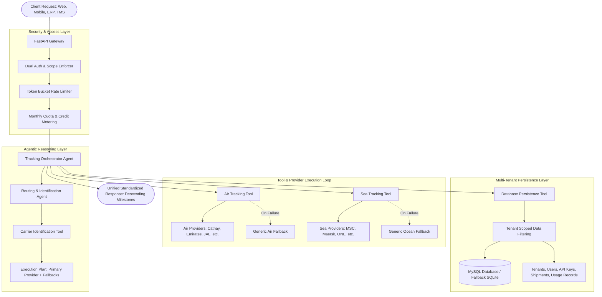

# Enterprise Multi-Tenant Cargo Tracking Platform (Air & Sea)

A production-grade, multi-tenant, subscription-managed cargo tracking SaaS platform modeled after modern AI developer API platforms (OpenAI / Stripe style).

---

## Architecture Overview



---

## Key Enterprise Features

1. **Subscription-Managed Quotas (Developer Platform Model)**:
   - **Developer (Free)**: 100 tracking credits/mo, 10 RPM, 2 API keys.
   - **Growth ($199/mo)**: 2,500 tracking credits/mo, 60 RPM, 10 API keys, batch tracking.
   - **Business ($699/mo)**: 15,000 tracking credits/mo, 300 RPM, 25 API keys, priority routing.
   - **Enterprise ($2,499/mo)**: 1,000,000+ tracking credits/mo, 1,200 RPM, custom carrier credentials, SLA.

2. **API Key-First Security (`cargotrk_live_...`)**:
   - Single-reveal plaintext key generation with SHA-256 database hashing.
   - Dual authentication: B2B machine-to-machine via `X-API-Key` or `Authorization: Bearer cargotrk_live_...`, and human dashboard sessions via JWT.
   - Fine-grained scopes: `tracking:live`, `tracking:read`, `shipments:batch`, `webhooks:write`, `admin:manage`.

3. **Multi-Tenant Data Isolation**:
   - Every shipment, tracking event, execution log, and usage record is strictly partitioned by `tenant_id`.
   - Tenants only access and monitor their own cargo portfolios.

4. **Real-Time Metering & Quota Enforcer**:
   - Live tracking consumes 1 credit per request; cached reads are free.
   - Returns standard HTTP `429 Too Many Requests` with reset date and upgrade prompt when quota is reached.

5. **20+ Air Airlines & Global Shipping Lines**:
   - Direct live tracking for Cathay Pacific (`160`), Emirates (`176`), Japan Airlines (`131`), Lufthansa (`020`), Singapore Airlines (`618`), etc.
   - Ocean container tracking for Mediterranean Shipping Company (MSC: `MEDU`, `MSCU`, `MSDU`, `MSMU`, `MSNU`) and Maersk (`MAEU`, `MRSU`, `MSKU`, `MRKU`, `HASU`, `SUDU`).
   - Chronological event sorting with newest milestones first (descending order).

---

## API Endpoints Summary

### Authentication & Account Management
| Method | Endpoint | Description |
|---|---|---|
| `POST` | `/api/v1/auth/register` | Onboard enterprise tenant, admin user, and initial API key |
| `POST` | `/api/v1/auth/login` | Authenticate user email & password, return JWT tokens |
| `GET` | `/api/v1/auth/me` | Current caller identity and tenant quota profile |

### API Key Management
| Method | Endpoint | Description |
|---|---|---|
| `POST` | `/api/v1/api-keys` | Generate new scoped API key (`cargotrk_live_...`) |
| `GET` | `/api/v1/api-keys` | List tenant's active API keys (masked prefixes) |
| `DELETE` | `/api/v1/api-keys/{id}` | Revoke an API key immediately |

### Subscription & Usage
| Method | Endpoint | Description |
|---|---|---|
| `GET` | `/api/v1/subscription/plans` | List available subscription tiers, pricing, and quotas |
| `GET` | `/api/v1/subscription/usage` | View real-time monthly tracking credits and remaining quota |
| `POST` | `/api/v1/subscription/upgrade` | Upgrade or switch subscription tier |

### Tracking & Shipment Portfolio
| Method | Endpoint | Description |
|---|---|---|
| `POST` | `/api/v1/track` | Live track single shipment (Air AWB or Sea Container), meters 1 credit |
| `POST` | `/api/v1/track/batch` | Bulk tracking (up to 100 queries) |
| `GET` | `/api/v1/shipments` | List tenant's tracked cargo with pagination and filters |
| `GET` | `/api/v1/shipments/{tracking_number}` | Full shipment timeline and execution logs |

---

## Running Locally

```bash
# 1. Install dependencies
pip install -r requirements.txt

# 2. Run the server
uvicorn app.main:app --host 0.0.0.0 --port 8000 --reload

# 3. Access Swagger Docs
open http://localhost:8000/docs
```

## Running Tests

```bash
PYTHONPATH=. pytest -v
```
